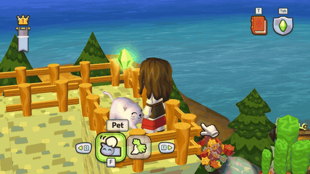

# Ms. Prissykins Pet & Feed

Give Ms. Prissykins some attention in MySims Kingdom. After Renée's tower quest, **Feed** her to invite her along and **Pet** her to ask her to stay. She keeps her original animations and sounds, including her idle meows and stretches.

**[Download v0.3.0](https://github.com/NekoCoaster/mysims-kingdom-ms-prissykins-pet-feed-patch/releases/download/v0.3.0/Prissykins-Petting-0.3.0.zip)**

For **Windows 64-bit, Steam build 21152538**. The mod checks your game version before enabling its changes.

## Install once, then play normally

1. Close MySims Kingdom. Download and extract the ZIP.
2. In Steam, right-click MySims Kingdom and choose **Manage > Browse local files**.
3. Copy **winmm.dll** from the ZIP into that folder, beside **MySimsKingdom.exe**. If another mod already installed a file with that name, don't overwrite it.
4. Double-click **Install.cmd** in the extracted download and select **MySimsKingdom.exe**. This sets up the game script once and backs up the original.
5. Start the game normally through Steam, load your save, and approach Ms. Prissykins. Allow a few seconds for **Pet** and **Feed** to appear.

The mod loads automatically when you start the game.

### Updating from v0.2.0

Close the game, extract the new ZIP, and run **Install.cmd** again. Keep your existing `winmm.dll`.

## Follow and Stay

Finish Renée's tower quest to use these commands:

- **Feed** to have her follow. She waits when she catches up and follows again when you walk away.
- **Pet** to have her stay where she is. She can still meow, stretch, and idle.

The command applies to the current area and resets when you reload your save.

## Good to know

- The mod does **not edit your save files**.
- If Windows denies access during the one-time script setup, right-click **Install.cmd** and choose **Run as administrator**.
- If a game update stops it working, check the [release page](https://github.com/NekoCoaster/mysims-kingdom-ms-prissykins-pet-feed-patch/releases).
- For troubleshooting, look for **PrissykinsProxy.log** in the game folder. It is refreshed each launch.

## Uninstall

Close the game, delete this mod's **winmm.dll** from the game folder, then run **Uninstall.cmd** from the extracted download to restore the original script. The uninstaller preserves later script edits and settings you added yourself.

## For developers

See [native/README.md](native/README.md) for the DLL build and [RESEARCH.md](RESEARCH.md) for the implementation notes. Build the DLL first, then run `Build-Release.ps1` to package it.

Unofficial community project, not affiliated with EA. The MIT license covers this project's source code, not the game or its assets.
